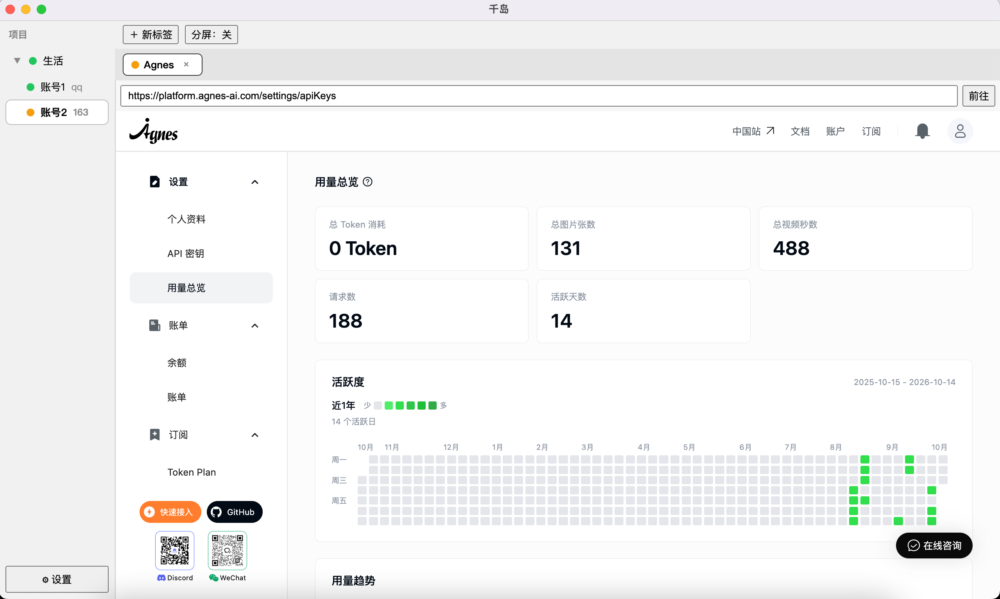
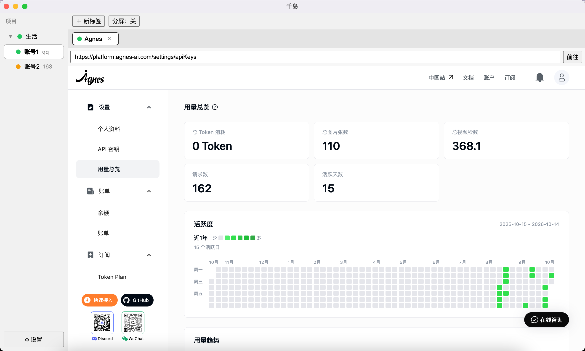

# 千岛

同一网站多登录身份同时在线、互不串号的桌面应用（Electron，macOS + Windows）。

组织模型：**项目**（分组，如"视频"）下挂多个**实例**，每个实例独立会话、登录一个账号，互不干扰。

## 应用截图

同一网站两个账号同时在线、数据各自独立（左栏"生活"项目下"账号1/账号2"两个实例）：





## 功能说明

### 1. 项目与实例：分组 + 独立会话

- **是什么**：**项目**只是分组（如"视频""生活"），不对应任何会话；**实例**才是真正的隔离会话空间，一个实例在同一时间只登一个站点账号。同一实例内的标签页共享同一套登录态，不同实例之间 Cookie、localStorage、缓存完全隔离。
- **怎么用**：
  - 左栏空白处右键 → 新建项目（建完自动带 1 个"实例一"，开箱即用）。
  - 右键项目 → 新建实例，一个账号建一个实例；右键项目/实例可改名、改色。
  - 右键实例 → 删除实例（先清该实例的分区会话数据再删元数据，清不掉则不删，可重试）；右键项目 → 删除项目（逐个清理其下全部实例会话后再删，需二次确认）。
  - 右键实例 → 清缓存（只清网络缓存，**登录态保留**，标签页自动重载）；清除全部站点数据（退出该实例所有登录，不可恢复，实例本身保留）。
  - 首次启动预置 5 个空项目（颜色各不相同），各带 1 个默认实例。
- **注意**：删实例/删项目/清站点数据都会掉登录，操作前确认账号归属；项目改名改色不影响会话。

### 2. 标签页、地址栏、分屏与弹窗

- **标签页**：每个标签归属一个实例，左栏切实例即切换对应标签栈；`＋ 新标签`默认开在当前实例（可在设置里改为"每次都问"，弹出实例选择浮层，选完才开）。
- **地址栏**：始终显示当前活动标签已提交导航的 URL，整页跳转、302、SPA 的 pushState/hash 变化都会跟随；输入回车即让当前标签跳过去，点 ⟳ / `Cmd+R` 只重载当前活动标签，其余标签、实例、分屏另一格、弹窗都不动，无活动标签时静默无操作。
- **重启恢复**：标签 URL、归属实例、活动位置、当前实例定时落盘到 `tabs.db`，重启后自动恢复并懒加载（切到才真正加载页面）；快照缺失或损坏时静默空启动，不挡应用打开；上次未完成的下载会被标记为失败（可重试）。
- **分屏**：顶栏"分屏"开关，同实例内左右并排看两个标签，方便对照（如两个账号的数据对比）；开关只影响当前实例的展示，不改变标签归属。
- **站内弹窗**：站内 `window.open` / 新窗口请求不会弹出系统窗口，默认转为应用内浮层弹窗（可多层叠加，关闭后自动刷新打开它的标签页，如登录态生效）；也可在设置里改为"应用内新标签"。链接类新窗口始终进标签。
- **注意**：webview 节点创建后不再重建，只切换显隐，所以切标签不会重载页面。

### 3. 页面区右键菜单

- **是什么**：网页内容区（地址栏/标签栏/侧栏之外）的右键菜单由主进程按上下文组装，分链接、图片、选中文字、空白四种。
- **怎么用**：
  - 空白处：后退 / 前进 / 重新加载（不可用时置灰）。
  - 链接上：多出"在新标签打开"（归属触发页的实例，不弹归属询问）、"复制链接地址"。
  - 图片上：多出"图片另存为"（走同实例下载链，自动落保存路径、进下载记录）、"复制图片地址"。
  - 有选中文字时：多出"复制选中文字"。
  - 四种上下文末尾都有"检查"：打开触发页的开发者工具并定位到点击的元素（见第 11 节）。
- **注意**：导航类操作在触发页直接执行，不会因切标签串到别的页面。

### 4. 下载中心

- **是什么**：Chrome 式的下载记录：顶栏"⤓ 下载"按钮 + 记录面板，内存列表 + `downloads.db` 全量落盘，重启还在。
- **怎么用**：
  - 点顶栏下载按钮打开面板，每条显示文件名、状态（下载中 / 已完成 / 已取消 / 下载失败）、进度条（总大小未知时降级为文字）、归属实例。
  - 下载中可取消（取消不打扰）；失败时按钮变"⤓ 下载 (N)"红点 + 右下 toast 即时提醒，面板点"重试"即用原 URL 重新发起（无续传，同实例分区优先以保住登录态，无标签时需先打开一个标签页；过期直链重试仍会失败，请回页面重新点下载）。
  - 重名文件自动续序号（如 `a (1).zip`），不覆盖旧文件；成功条目可"打开所在文件夹"。
- **注意**：下载物视为会话数据的一种，需要登录态的下载请在对应的实例标签里发起。

### 5. 下载目录：应用默认 + 实例覆盖

- **是什么**：下载文件存哪，分两级：应用级默认下载目录 + 实例级专属覆盖（实例没单独设时显示"跟随全局"）。
- **怎么用**：
  - 设置页"默认下载目录" → 选择… / 恢复系统默认（空即跟随系统默认下载目录），点保存才生效（草稿制）。
  - 右键实例 → 更改下载目录 / 恢复跟随全局；恢复时会提示"专属目录将被清除，以后跟随应用默认"。
- **注意**：目录不可用（被删、无权限等）时自动回退系统默认并通知，不会让下载凭空消失。

### 6. 书签

- **是什么**：收藏的网址条目 = URL + 收藏时标签页标题（取不到回退 URL）+ 归属实例 + 收藏时间，按时间倒序展示，`bookmarks.db` 落盘，损坏时静默空列表。
- **怎么用**：
  - 地址栏 ☆ 收藏当前页（再点即取消收藏，toggle 语义），侧栏"书签"区浏览全部，点条目即在归属实例开新标签（登录态才对）。
  - 点 ✕ 删除书签；侧栏书签区可收起/展开（状态记设置）。
- **注意**：归属实例被删后书签保留，点击时回退到当前实例打开。

### 7. 账号标注与防串号提醒

- **是什么**：给实例手工标注它登的是哪个站点账号（如"Gmail 的 a@gmail.com"），空即未标注；同一标注出现在 ≥2 个实例即算冲突（全局比对，不分项目，原样比对不归一大小写）。
- **怎么用**：右键实例 → 标注账号（空字串即清除标注）；标注重复的实例常驻红点，保存标注当时若正处冲突还会弹系统通知"xx 同时出现在 N 个实例中，请确认是否为误操作"。
- **注意**：常驻红点不受"同账号冲突时发系统通知"开关影响（开关只关系统通知）；空白标注不参与比较。

### 8. 引导页、设置、快捷键与侧栏

- **引导页**：首次启动自动弹出，讲"项目 → 实例 → 标签"模型并带三步建实例；看过后记标记不再自动弹，设置页留"查看使用引导"常驻入口。
- **设置页**（左栏 ⚙，草稿制，点保存才生效）：
  - 新标签默认归属：当前实例 / 每次都问。
  - 站内新窗口行为：应用内弹窗 / 应用内新标签。
  - 同账号冲突时发系统通知：开关（红点常驻不受影响）。
  - 默认下载目录：选择… / 恢复系统默认。
  - 全局自定义 UA：留空即伪装纯 Chrome（见第 10 节）。
  - 快捷键静态表 + 引导入口。
- **快捷键**（mac 显示 Cmd，其余平台显示 Ctrl，与菜单实际生效一致）：
  - `Cmd+T` 当前实例新标签；`Cmd+W` 关闭当前标签（关到最后一个留空态）。
  - `Cmd+Shift+[ / ]` 上一个 / 下一个标签；`Cmd+L` 聚焦地址栏；`Cmd+R` 重载当前标签；`Cmd+Shift+I` 切换实例开发者工具（见第 11 节）。
- **侧栏**：项目 → 实例两级树，可折叠项目；分隔条拖拽无级调宽（120–400px，松手落盘），双击切换收起/展开，收起后顶栏出现"☰ 侧栏"按钮再展开；宽窄与收起态都记设置。侧栏头有收起按钮，底部有设置入口。

### 9. 数据与隐私：隔离机制与文件位置

- **隔离机制**：每个实例独占一个 Electron 持久化分区（`persist:mp-<实例id>`），Cookie、Storage、缓存落盘，重启保留；删实例/删项目先清分区再删元数据，清缓存只清网络缓存，清站点数据复用删实例的 wipe（掉登录、留实例）。
- **文件位置**（`projects.json` 元数据明文，其他 sqlite/JSON 见下）：
  - macOS：`~/Library/Application Support/multi-persona/`；Windows：`%APPDATA%/multi-persona/`。
  - `projects.json` 项目+实例元数据、`settings.json` 应用设置、`tabs.db` 标签快照、`downloads.db` 下载记录、`bookmarks.db` 书签、`Partitions/persist:mp-<实例id>/` 各实例会话。
- **健壮性**：标签/书签/下载/设置文件缺失或损坏一律静默回退（空启动/空列表/默认值），落盘失败不影响当前会话；项目存储损坏则抛错不静默覆盖，并支持旧版项目级数据的包层迁移（老项目自动获得 1 个默认实例，分区名不变、会话零丢失）。

### 10. 用户代理（UA）：伪装 Chrome + 自定义

- **是什么**：默认把 Electron 尾巴抹掉、对网站伪装成纯 Chrome（部分站点如知乎会嗅探 UA 拦截 Electron，伪装后即正常打开）；两级自定义：应用级全局 UA + 实例级专属覆盖，回退链为实例覆盖 → 全局自定义 → 纯 Chrome 伪装。
- **怎么用**：
  - 设置页"全局自定义 UA" → 手工填入，输入时实时显示当前生效值，保存后二次确认是否重载全部标签。
  - 右键实例 → 设置 UA…（弹窗预填当前专属值，留空即跟随全局），保存后二次确认是否重载该实例标签页。
- **注意**：UA 只对新导航生效，已打开页面必须重载；清空专属值即恢复跟随全局；非法字符（换行等）会被拒绝。

### 11. 实例开发者工具

- **是什么**：打开网页实例页面（而非主窗口）的 DevTools，用于调试页面、查网络请求、验 UA 生效（Console 输 `navigator.userAgent`）。
- **怎么用**（三入口，都只作用当前活动标签，再按一次关闭）：
  - 视图菜单"切换实例开发者工具"（`Cmd+Shift+I`）。
  - 页面区右键"检查"（四种上下文都有，打开时直接定位到点击的元素）。
- **注意**：视图菜单里 Electron 原生那条 Toggle 开的是主窗口的，与实例无关；打包后的 release 版不再显示主窗口那条。

## 快速开始

```bash
npm install
npm run dev
```

1. 左栏右键空白处 → 新建项目（如"视频"）。
2. 右键项目 → 新建实例，一个账号建一个实例。
3. 在实例里打开网站并登录；不同实例同站登录互不串号。
4. 右键实例可改名/改色/标注账号/清缓存；标注重复会有红点+系统通知提醒。

## 常用命令

| 命令            | 说明                    |
|-----------------|-------------------------|
| `npm install`   | 安装依赖                |
| `npm start`     | 启动应用（需先 build）  |
| `npm run dev`   | 本地启动（先 build 再启动，一步到位）|
| `npm run build` | TypeScript 编译到 dist/ |
| `npm run typecheck` | 仅类型检查          |
| `npm test`      | vitest 单测             |
| `npm run dist`  | 打 macOS dmg（release/）|
| `npm run dist:win` | 打 Windows exe（release/，mac cross-build，需真机验证后才可发版）|

## 数据位置

- macOS：`~/Library/Application Support/multi-persona/`（`projects.json` 元数据明文、`settings.json`、`tabs.db` 标签快照、`downloads.db` 下载记录、`Partitions/persist:mp-<实例id>/` 各实例会话）
- Windows：`%APPDATA%/multi-persona/` 下同名结构

## 说明

- 术语与决策见 `CONTEXT.md`、`docs/adr/`。
- 需求总览见 GitHub issue #1，任务拆分见子 issues。
